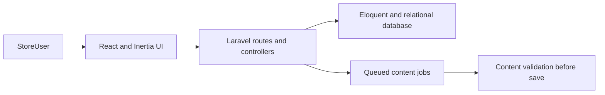
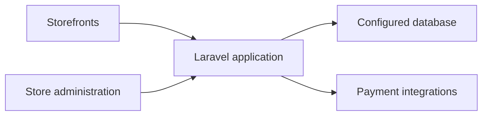

# Mtjri (Tijraa)

## Status

Public repo / local build — Run the Laravel application locally with seeded or configured data.

## Problem

Store operators need catalog, inventory and order workflows across multiple storefronts. Store-scoped access and validated generated content keep one store's data and content changes within its boundary.

## Architecture



## Key decisions

- The web installer guides first-time setup, trading a smoother setup path for an additional installation surface.
- Store context is applied to business data, requiring tenant-aware reads and writes across modules.
- AI content is queued and validated before saving, which adds latency but keeps generated text out of persisted state until checks pass.

## Run locally

```bash
composer install
npm install
cp .env.example .env
php artisan key:generate
php artisan serve
# In another terminal:
npm run dev
```

## Tests

```bash
php artisan test
npm run test
```

Count omitted: PHP is not installed in this session, and JavaScript test dependencies were not installed.

## Limitations

- Payment gateways and external integrations require configuration and are not verified by a local README review.
- The interface and seeded data represent a local build; no hosted availability is claimed.

---

## Existing project documentation

A powerful SaaS application for creating and managing multiple online stores built with Laravel and React.

## Setup Instructions

### Option 1: Web Installer (Recommended)

1. Clone the repository
2. Install dependencies:
   ```
   composer install
   npm install
   ```
3. Copy `.env.example` to `.env` and configure your database
4. Generate application key:
   ```
   php artisan key:generate
   ```
5. Start the development server:
   ```
   php artisan serve
   npm run dev
   ```
6. Visit your application URL - you'll be automatically redirected to the installer
7. Or manually visit `/setup` to access the web installer
8. Click "Install Application" to run migrations and seeders automatically

### Option 2: Manual Installation

1. Clone the repository
2. Install dependencies:
   ```
   composer install
   npm install
   ```
3. Copy `.env.example` to `.env` and configure your database
4. Generate application key:
   ```
   php artisan key:generate
   ```
5. Run migrations and seeders:
   ```
   php artisan migrate
   php artisan db:seed
   ```
6. Start the development server:
   ```
   php artisan serve
   npm run dev
   ```

## Web Installer Features

- **Automatic Installation**: No need to run `php artisan migrate` manually
- **Update Detection**: Automatically detects when new migrations are available
- **One-Click Updates**: Update database schema with a single click
- **Status Monitoring**: Real-time installation and update status
- **Error Handling**: Clear error messages and troubleshooting guidance

## Default Users

After running the seeders, you can log in with the following credentials:

- Super Admin:
  - Email: superadmin@example.com
  - Password: password

- Admin:
  - Email: admin@example.com
  - Password: password

## Features

- **Multi-Store SaaS Platform**: Create and manage unlimited online stores from one dashboard
- **Multiple Store Themes**: Choose from 10+ professional themes (Fashion, Electronics, Beauty, Jewelry, Watches, Furniture, Cars, Baby & Kids, Perfume, Home & Accessories)
- **Complete E-commerce Features**: Product management, inventory tracking, order processing
- **Payment Integration**: Multiple payment gateway support for each store
- **Customer Management**: Manage customers, orders, and reviews across all stores
- **Blog System**: Built-in blog functionality for each store
- **Subscription Plans**: SaaS subscription management with different tiers
- **Role-based Access Control**: Admin, store managers, and customer roles
- **Analytics Dashboard**: Track performance across all stores
- **Responsive Design**: Mobile-first approach for all store themes

## Store Themes Available

- **Home & Accessories** (Default)
- **Fashion & Apparel**
- **Electronics & Technology**
- **Beauty & Cosmetics**
- **Jewelry & Accessories**
- **Watches & Timepieces**
- **Furniture & Interior**
- **Cars & Automotive**
- **Baby & Kids**
- **Perfume & Fragrances**

## License

The Tijraa platform is open-sourced software licensed under the [MIT license](https://opensource.org/licenses/MIT).
# mtjri

## Portfolio summary

### Problem
Small businesses need to create and operate multiple branded online stores from one commerce platform.

### Architecture


### Key decisions
- Support multiple store themes within one application.
- Provide a web installer for initial setup.
- Keep commerce workflows and payment integrations in the Laravel backend.

### How to run
Follow [Setup Instructions](#setup-instructions). The README does not document a Docker setup.

### Tests
No test command or verified test total is documented in this README.

### Status
Public repo / local build.
